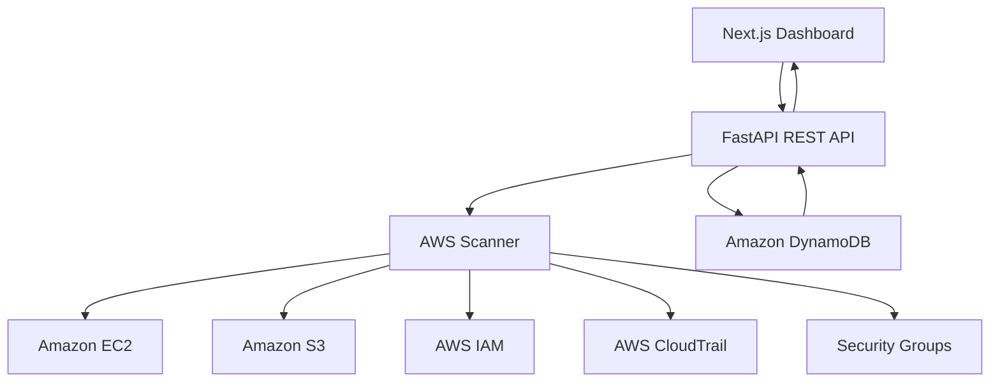

# Cloud Posture Scanner

An AWS Cloud Security Posture Scanner that discovers cloud resources, evaluates security configurations against five CIS-inspired checks, and stores scan results in Amazon DynamoDB.

Built using FastAPI, Python, Boto3, Next.js, React, and AWS.

## Features

- **EC2 Discovery:** Instance ID, instance type, AWS region, public IP, and security groups.
- **S3 Discovery:** Bucket name, region, encryption configuration, and public access posture.
- **Security Assessment:** Five CIS-inspired security checks with PASS, FAIL, ERROR, and UNKNOWN results.
- **AWS Integration:** Live resource discovery using Boto3 and AWS IAM permissions.
- **Data Persistence:** Scan results stored in Amazon DynamoDB.
- **REST API:** FastAPI endpoints for resource inventory, security results, and scan execution.
- **Dashboard:** Next.js frontend displaying resource inventory and security findings.
- **Demo Mode:** Test the application without connecting to AWS.

## Technology Stack

| Component | Technology |
|---|---|
| Frontend | Next.js, React |
| Styling | Tailwind CSS |
| Backend | Python, FastAPI |
| AWS SDK | Boto3 |
| Cloud Provider | Amazon Web Services |
| Database | Amazon DynamoDB |
| API Documentation | Swagger / OpenAPI |

## Architecture



## Security Checks

The scanner implements five CIS-inspired security checks:

| Check | Description |
|---|---|
| S3 Public Access | Identifies publicly accessible S3 buckets |
| S3 Encryption | Checks bucket encryption configuration |
| Root MFA | Verifies root account MFA status |
| CloudTrail | Checks whether CloudTrail logging is enabled |
| SSH/RDP Exposure | Identifies security groups exposing SSH/RDP to the internet |

Each check returns:
- **PASS:** Security requirement satisfied.
- **FAIL:** A security issue was detected.
- **ERROR:** The check could not be completed because of an error.
- **UNKNOWN:** Available information was insufficient to evaluate the check.

These are CIS-inspired assignment checks, not a claim of complete CIS AWS Foundations Benchmark compliance or certification.

## Project Structure

```text
cloud-posture-scanner/
│
├── backend/
│   ├── app/
│   │   ├── main.py
│   │   ├── scanner.py
│   │   ├── config.py
│   │   └── demo.py
│   ├── requirements.txt
│   └── .env
│
├── frontend/
│   ├── app/
│   ├── package.json
│   └── .env.local
│
├── infra/
│   └── iam-policy.json
│
├── .gitignore
└── README.md
```

## Prerequisites

- Python 3.11 or later
- Node.js 20 or later
- npm
- AWS account for live scanning
- AWS CLI for AWS configuration

## Installation and Setup

### 1. Clone the repository

```bash
git clone <YOUR_GITHUB_REPOSITORY_URL>
cd cloud-posture-scanner
```

### 2. Backend Setup

Open a terminal:

```powershell
cd backend

py -3.12 -m venv .venv

.\.venv\Scripts\Activate.ps1

pip install -r requirements.txt
```

Create the environment file:

```powershell
Copy-Item .env.example .env
```

Configure Demo Mode:

```env
DEMO_MODE=true
AWS_REGION=ap-south-1
DYNAMODB_TABLE=cloud-posture-scans
CORS_ORIGINS=http://localhost:3000
```

Start the backend:

```powershell
python -m uvicorn app.main:app --reload
```

Backend: http://127.0.0.1:8000

Swagger API Documentation: http://127.0.0.1:8000/docs

### 3. Frontend Setup

Open another terminal:

```powershell
cd frontend

npm install

Copy-Item .env.local.example .env.local

npm run dev
```

Frontend Dashboard: http://localhost:3000

## AWS Configuration

For live scanning:

1. Create an AWS account.
2. Enable MFA on the root account.
3. Create a dedicated IAM identity for the scanner.
4. Configure the least-privilege IAM policy from `infra/iam-policy.json`.
5. Create a DynamoDB table named `cloud-posture-scans`.
6. Set the partition key to `scan_id` with type String.
7. Configure AWS CLI credentials for the dedicated IAM identity.

Verify AWS CLI access:

```powershell
aws sts get-caller-identity
```

Configure `backend/.env`:

```env
DEMO_MODE=false
AWS_REGION=ap-south-1
DYNAMODB_TABLE=cloud-posture-scans
CORS_ORIGINS=http://localhost:3000
```

Restart the backend after changing the environment configuration.

**Security:** Never commit AWS access keys, secret keys, or `.env` files to GitHub. Never use root account access keys for the scanner.

## API Endpoints

| Method | Endpoint | Purpose |
|---|---|---|
| GET | `/health` | Backend health and operating mode |
| GET | `/instances` | EC2 inventory |
| GET | `/buckets` | S3 inventory |
| GET | `/cis-results` | Security check results |
| GET | `/summary` | Resource and security summary |
| POST | `/scan` | Execute a scan and store results |

Interactive API documentation:

http://127.0.0.1:8000/docs

## Data Storage

Amazon DynamoDB stores scan results using:

- `scan_id`
- `generated_at`
- `instances`
- `buckets`
- `cis_results`

Each scan is stored as a separate item in the configured DynamoDB table.

## Security Considerations

- Uses a dedicated IAM identity instead of root access keys.
- Uses restricted AWS permissions for resource discovery.
- Stores scan results in DynamoDB.
- Reports inaccessible or unevaluable checks as ERROR or UNKNOWN instead of incorrectly marking them as PASS.
- Uses root MFA status from the IAM credential report.
- Evaluates S3 public access using bucket policy status and ACL information, alongside public access block configuration.

## Current Limitations

- S3 security checks return UNKNOWN when no buckets are available to inspect.
- CloudTrail check requires accessible logging-trail information.
- The scanner evaluates the five specified assignment checks, not the complete CIS benchmark.
- A single DynamoDB item stores the complete scan result; large inventories may require a different storage design because of DynamoDB item-size limits.
- Account-level S3 public access settings and additional policy edge cases may require further evaluation.

## Future Improvements

- Add more CIS AWS Benchmark checks.
- Support scheduled security scans.
- Add scan history and comparison.
- Improve dashboard filtering and reporting.
- Add downloadable security assessment reports.
- Add automated testing and CI/CD.
- Support larger inventories and paginated scan history.

## Cost Considerations

AWS services may incur charges depending on usage, region, and account eligibility. Review AWS pricing and billing alerts before deploying additional resources.

## Disclaimer

This project is developed for educational and demonstration purposes. Its CIS-inspired checks should not be treated as a complete compliance audit or security certification.
